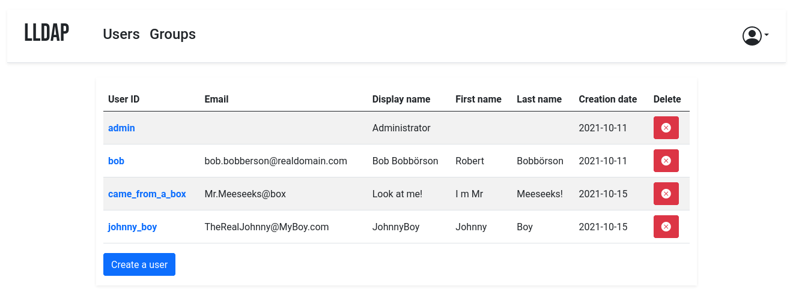

# LLDAP

LLDAP is a lightweight LDAP server for user management, with a web UI: create users and groups, set passwords, and give your self-hosted apps (Nextcloud, Gitea, Jellyfin, Authelia, and anything else that speaks LDAP) a single source of truth for authentication. It is a single tiny Rust service with an embedded SQLite database — no companion database, ~2 MB of RAM at rest — built for anyone who wants LDAP without running OpenLDAP or FreeIPA.

*LLDAP's users list — upstream screenshot from the LLDAP project (`screenshot.png`), showing the user table and the create-user action. The live UI was verified rendering during end-to-end testing of this template's own deployment.*

## Source Repository

[https://github.com/INAPP-Mobile/lldap](https://github.com/INAPP-Mobile/lldap)

## Deploy and Host

One-click deploy creates a single LLDAP service with a persistent volume. No companion database is needed: LLDAP stores users, groups, and settings in SQLite under the volume. On first boot the wrapper maps Railway's injected `PORT` onto LLDAP's HTTP port, the upstream entrypoint copies its default config onto the volume, and the admin account is seeded from the generated deploy-form password. There is no setup wizard and no email step: open the public URL and log in as `admin` with the generated `LLDAP_LDAP_USER_PASS` shown on the deploy form.

After deploy, log in as `admin`, create a user (user ID, email, display name, password) and it appears in the users table; create a group and add members to it. Your other apps then bind to the LDAP server with `cn=admin,ou=people,dc=example,dc=com` and the admin password.

## Why Deploy

- One login for every app: users and groups in one place, consumed by any LDAP-capable service instead of a separate account per app.
- Tiny footprint: a single Rust binary, ~2 MB RAM at rest, SQLite on a persistent volume — no database service to run or pay for.
- Admin UI included: manage users, groups, and passwords from the browser; no LDAP client or command line needed for day-to-day use.
- Groups that work: `memberOf` support, so apps can filter by group (e.g. only `cn=admins,ou=groups,dc=example,dc=com` may sign in).
- Self-hosted data: your user directory stays on your Railway volume, with no tracking and no subscription.
- Password resets by email (optional): configure SMTP and users can reset their own passwords from the login page.

## Common Use Cases

- Homelab SSO-lite: one user directory for Nextcloud, Gitea, Jellyfin, and other self-hosted apps that support LDAP.
- Small teams: a handful of users and groups with per-app access controlled by group membership.
- A front-end for Authelia / Keycloak / Authentik: LLDAP as the user store behind a full SSO portal.
- Replacing a spreadsheet of accounts: real user management with password policies instead of shared logins.

## Configuration

The one-click deploy form has four generated fields — no typing required. Everything else is baked into the image; applicable upstream variables and their baked values:

| Variable | Value | Description |
| --- | --- | --- |
| `LLDAP_LDAP_USER_PASS` | `${{secret(32)}}` | Admin password for the web UI and LDAP bind (user `admin`). Seeded once on first boot; changing it later does not reset the password. |
| `LLDAP_JWT_SECRET` | `${{secret(32)}}` | Random secret for JWT signatures. Changing it invalidates all user sessions. |
| `LLDAP_KEY_SEED` | `${{secret(32)}}` | Random seed for the server private key that protects stored passwords. Keep it stable. |
| `LLDAP_HTTP_URL` | `https://${{RAILWAY_PUBLIC_DOMAIN}}` | Public URL of the server, used in password-reset email links. |
| `PORT` | Railway-injected | The HTTP port: the wrapper exports it as `LLDAP_HTTP_PORT` on every boot (upstream default 17170, and upstream ignores generic `PORT`). |
| `LLDAP_LDAP_BASE_DN` | `dc=example,dc=com` | Base DN for the directory (baked; change the service variable before first boot if you want your own domain, e.g. `dc=mycompany,dc=com`). |
| `LLDAP_LDAP_USER_EMAIL` | `admin@example.com` | Admin email, used only when initially creating the admin user (baked). |
| `LLDAP_LDAP_PORT` | `3890` | LDAP port (baked). Internal only — see below. |
| `LLDAP_DATABASE_URL` | `sqlite:///data/users.db?mode=rwc` | SQLite database on the volume (baked). |
| `LLDAP_SMTP_OPTIONS__*` | unset | Optional password-reset email: `ENABLE_PASSWORD_RESET`, `SERVER`, `PORT`, `SMTP_ENCRYPTION`, `USER`, `PASSWORD`, `FROM`. See `.env.example`. |
| `LLDAP_LDAPS_OPTIONS__*` | unset | Optional LDAPS (LDAP over TLS): `ENABLED`, `PORT`, `CERT_FILE`, `KEY_FILE` (cert files on `/data`). |

## Persistence

One volume mounted at `/data` holds the config (`/data/lldap_config.toml`, created from the upstream template on first boot) and the SQLite database (`/data/users.db`). Restarts and redeploys keep users, groups, and settings. Back up the volume to back up LLDAP.

## LDAP access from other services

Railway's public edge is HTTP-only, so the LDAP port (3890) is **not** publicly reachable — the public face of this template is the web UI. Other services in the same Railway project can reach the LDAP server over the private network using the service's private hostname on port 3890. Bind DN for the admin: `cn=admin,ou=people,dc=example,dc=com`. LDAPS is off by default; enable it with `LLDAP_LDAPS_OPTIONS__ENABLED=true` and cert files on the volume if your clients require TLS.

## Deployment Dependencies

- Plan tier: works on Railway's entry tiers; a single always-on service with a persistent volume.
- RAM needs: very light — one Rust service, ~2 MB at rest, no companion database or cache service.
- Upstream: [LLDAP v0.6.3](https://github.com/lldap/lldap) (GPL-3.0), image pinned by manifest digest.
