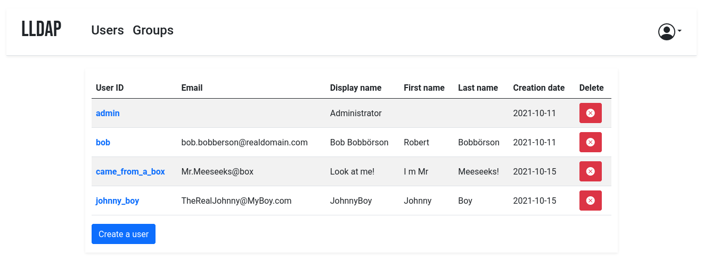

*LLDAP's users list — upstream screenshot from the LLDAP project (`screenshot.png`). The live UI was verified rendering during end-to-end testing of this template's own deployment.*

# Deploy and Host

LLDAP is a lightweight LDAP server for user management, with a web UI: create users and groups, set passwords, and give your self-hosted apps (Nextcloud, Gitea, Jellyfin, Authelia, and anything else that speaks LDAP) a single source of truth for authentication. One-click deploy creates a single LLDAP service with a persistent volume and no companion database: users, groups, and settings live in SQLite on the volume. After deploy, open the public URL and log in as `admin` with the generated password shown on the deploy form — there is no setup wizard and no email step.

## About Hosting

Hosting LLDAP on Railway keeps your user directory on your own volume instead of a SaaS. The deployment is a single always-on Rust service: the wrapper maps Railway's injected `PORT` onto LLDAP's HTTP port on every boot (upstream ignores generic `PORT`), the upstream entrypoint seeds the admin account from the generated deploy-form password, and the SQLite database lives on the volume. The deploy form has three generated fields and nothing to type.

## Why Deploy

- One login for every app: users and groups in one place, consumed by any LDAP-capable service instead of a separate account per app.
- Tiny footprint: a single Rust binary, ~2 MB RAM at rest, SQLite on a persistent volume — no database service to run or pay for.
- Admin UI included: manage users, groups, and passwords from the browser; no LDAP client or command line needed for day-to-day use.
- Groups that work: `memberOf` support, so apps can filter by group (e.g. only `cn=admins,ou=groups,dc=example,dc=com` may sign in).
- Self-hosted data: your user directory stays on your Railway volume, with no tracking and no subscription.
- Password resets by email (optional): configure SMTP and users can reset their own passwords from the login page.

## Common Use Cases

- Homelab SSO-lite: one user directory for Nextcloud, Gitea, Jellyfin, and other self-hosted apps that support LDAP.
- Small teams: a handful of users and groups with per-app access controlled by group membership.
- A front-end for Authelia / Keycloak / Authentik: LLDAP as the user store behind a full SSO portal.
- Replacing a spreadsheet of accounts: real user management with password policies instead of shared logins.

## Dependencies for

- A single LLDAP service (Rust, SQLite, no companion service).
- One persistent volume mounted at `/data` (config at `/data/lldap_config.toml`, SQLite database at `/data/users.db`).
- Environment variables (condensed reference — full documentation in the repo README):

| Variable | Default | Description |
| --- | --- | --- |
| `LLDAP_LDAP_USER_PASS` | `${{secret(32)}}` | Admin password (user `admin`), seeded once on first boot. |
| `LLDAP_JWT_SECRET` | `${{secret(32)}}` | Random secret for JWT signatures. |
| `LLDAP_KEY_SEED` | `${{secret(32)}}` | Random seed for the server private key protecting stored passwords. |
| `LLDAP_HTTP_URL` | derived at boot | Public URL, used in password-reset email links. Derived from the live Railway domain by the wrapper entrypoint; never set it to `https://${{RAILWAY_PUBLIC_DOMAIN}}` as a variable — it resolves to a bare `https://` on first deploy and LLDAP rejects it hard ("empty host"). |
| `PORT` | Railway-injected | HTTP port, exported as `LLDAP_HTTP_PORT` by the wrapper on every boot. |
| `LLDAP_LDAP_BASE_DN` | `dc=example,dc=com` | Base DN for the directory (baked). |
| `LLDAP_LDAP_PORT` | `3890` | LDAP port (baked). Internal only — Railway's public edge is HTTP-only, so LDAP is reachable from other services in the same project over the private network, not from the internet. |
| `LLDAP_DATABASE_URL` | `sqlite:///data/users.db?mode=rwc` | SQLite database on the volume (baked). |
| `LLDAP_SMTP_OPTIONS__*` | unset | Optional password-reset email settings. |
| `LLDAP_LDAPS_OPTIONS__*` | unset | Optional LDAPS (LDAP over TLS) settings. |

### Deployment Dependencies

- Plan tier: works on Railway's entry tiers; a single always-on service with a persistent volume.
- RAM needs: very light — one Rust service, ~2 MB at rest, no companion database or cache service.
